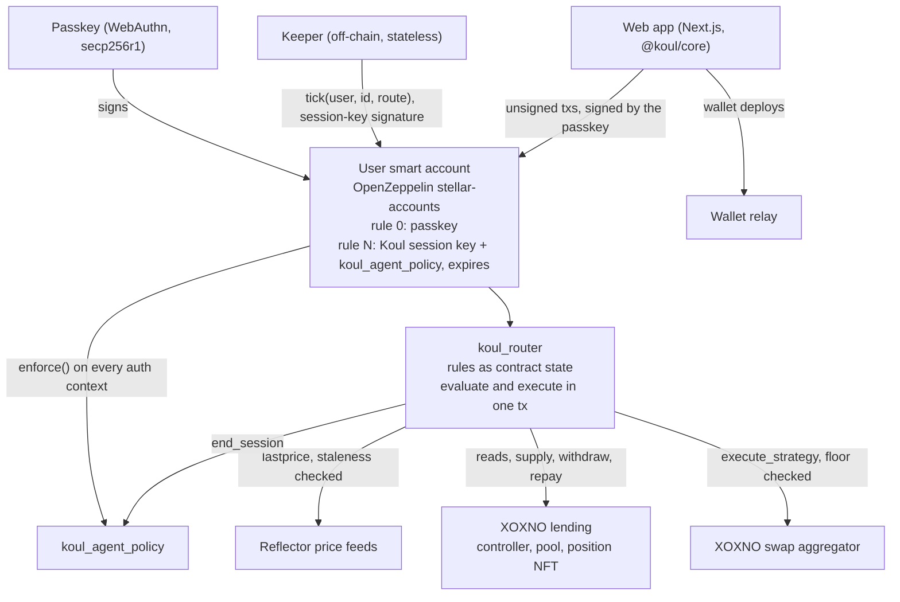
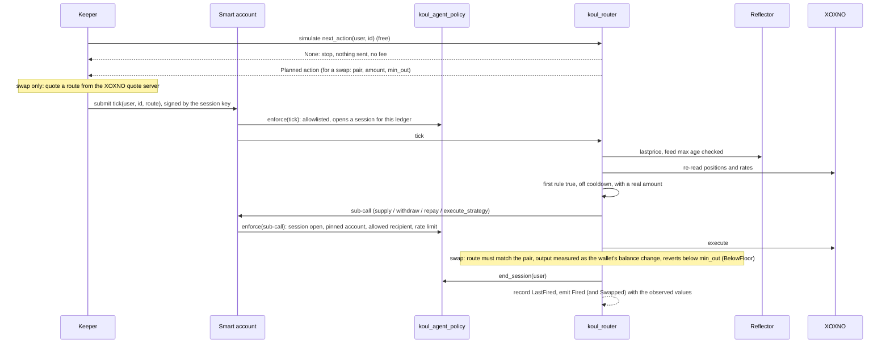

# Koul: technical architecture

Koul lets a person write "if this, then that" rules for their money on Stellar. The rules run from the person's own
passkey smart account, and the person keeps custody. This document covers how Koul uses Stellar today, component by
component, and what the SCF #46 Build Award would fund: taking the Koul autopilot to mainnet, with on-chain indicators,
trailing stops and brackets, Zenex perpetuals and pull oracles.

Everything described as live runs on Stellar **testnet**. Code: https://github.com/koul-me/koul (MIT). Every on-chain
change is logged with its transaction hash in [`docs/build-log.md`](build-log.md).

How this document was written: drafted with AI assistance (Claude Code) from the code, the build log, the chain and
the providers' documentation, then reviewed and edited by the team. Every number in it was checked against the code,
the chain, koul.me/status or the provider's documentation.

---

## 1. The design in one line

**The rules, the decision and the execution are on-chain. The keeper is only a clock.**

Safety is enforced on-chain, and liveness comes from off-chain. A keeper can stop rules from firing. It cannot invent
an action, move funds anywhere except the user's own position, or touch another account.

### Why this is built on Stellar

Koul uses four things together, in one transaction, that Stellar provides natively:

- **Custom account authorisation.** The user's wallet is a contract whose `__check_auth` runs a policy on every call
  a key signs, including sub-calls. Koul's whole safety model is a policy on a context rule of that account.
- **Passkeys verified on-chain.** secp256r1 signatures are checked by the network, so a phone's passkey is the wallet's
  owner with no seed phrase and no server holding a key.
- **Read, decide and act in one invocation.** A Soroban call can read XOXNO positions and Reflector prices, evaluate
  the rules and execute the action atomically, under one authorisation tree. If the world changed since the keeper
  looked, the transaction does nothing.
- **Fees low enough to check often.** The keeper simulates every autopilot on every pass, which costs nothing, and
  pays a fee only when an action runs.

The venues and price sources are on Stellar too: XOXNO lending and its swap aggregator, Reflector price feeds and
Stellar Asset Contract tokens today; Zenex perpetuals, Pyth Pro and Chainlink Data Feeds in this award.

---

## 2. Components

| Component | Stellar primitive | What it does |
|---|---|---|
| `koul_router` | Soroban contract (Rust, soroban-sdk 26.1) | Stores each user's autopilots as persistent contract state. On `tick` it re-reads the world, picks the first rule that is true, off cooldown and has a real amount to move, and executes it in the same transaction. At most one action per tick. |
| `koul_agent_policy` | OpenZeppelin `Policy` on a smart-account context rule | Confines Koul's session key. Runs `enforce` on the root call and on every sub-invocation the key authorises (section 5). |
| User smart account | OpenZeppelin `stellar-accounts` (rev `1e513890`), deployed through Sembol and smart-account-kit 0.6.2 | Rule 0 holds the user's passkey (WebAuthn verifier). A second context rule holds Koul's Ed25519 session key bound to `koul_agent_policy`, with an expiry of 1 to 30 days. Removing that rule stops everything at once. |
| Keeper | TypeScript, `@stellar/stellar-sdk` 16.4.1 | Lists users and autopilots from the router, simulates, and submits a tick only when the router says an action applies. Holds no user funds, makes no decisions, keeps no state. |
| `@koul/core` | TypeScript SDK | Types that mirror the contracts, the ScVal codec, validation against the contract's limits, reads, and unsigned write builders. Shared by the app and the keeper. |
| Web app | Next.js | Every write is an unsigned transaction the user signs with their passkey. The chat that turns a sentence into rules returns data only; it is validated against the contract's limits and becomes state only after the user signs. |
| Wallet relay | `web/app/api/relay` | Pays for wallet deploys and passes every other request on to SDF's public relayer. |
| Reflector | Price feeds (`lastprice`) | Prices for price conditions and for the swap floor. Each feed is registered with a maximum age (900 s on testnet); a missing or stale price never matches. |
| XOXNO | Lending controller, pool, position NFT, swap aggregator | The venues. The position NFT's token id is the user's XOXNO account id, so the app finds a position without storing anything. |
| `koul_mock_fx` | Reflector's read interface | Testnet-only mock FX feed, off in the app and not used on mainnet. |

---

## 3. The rule model

- An **autopilot** is an ordered list of up to **32 rules** (`MAX_RULES`).
- A **rule** has **1 to 3 conditions** (`MAX_CONDITIONS`) joined by all or any, one action, and a mandatory cooldown in
  ledgers. A condition that stays true would otherwise fire every pass and grind a position down through fees.
- **Conditions:** health factor, supply rate, supply-rate gap between two hubs, idle USDC, token balance, token price
  (Reflector).
- **Actions:** supply from the wallet, move supply between hubs, repay from the wallet, repay with collateral,
  withdraw to the wallet, swap from the wallet, withdraw and swap. Swaps cover XLM, ETH, SOL, XRP, wBTC, BTC, USDT and
  EURC.
- No if/else and no nesting. That keeps a rule easy to read, to validate on-chain and to show honestly in a UI.

| Data | Where | On-chain |
|---|---|---|
| Rules (`Autopilot { account_id, rules }`) | Router persistent storage, `Autopilot(user, id)` | Yes |
| Cooldown state | `LastFired(user, id, rule_index)` | Yes |
| What the session key may do | Policy storage, `Params(smart_account, rule_id)` | Yes |
| That the session key exists, and its expiry | Smart-account context rules | Yes |
| What happened | `Fired`, `Swapped`, `AutopilotSet`, `AutopilotCleared` events | Yes |
| Keeper heartbeat, status page data | Redis | No, monitoring only |

Anyone can read an autopilot with `get_autopilot(user, id)`, and the live truth of each condition, with the value it
was compared against, with `check(user, id)`.

### Contract interfaces

`koul_router` (`contracts/koul_router/src/lib.rs`):

| Function | Who must authorise | Storage it touches |
|---|---|---|
| `__constructor(admin, controller, pool, usdc, oracle, spoke_id)` | Deployer, once | Instance: admin, config |
| `upgrade(new_wasm_hash)` | Admin | Contract wasm (address and storage unchanged) |
| `set_oracle(oracle)` | Admin | Instance: config |
| `set_feed(token, feed)` | Admin | Persistent: `Feed(token)` |
| `set_aggregator(aggregator)`, `set_policy(policy)` | Admin | Instance |
| `set_autopilot(user, id, autopilot)` | `user` (the passkey) | Persistent: `Autopilot(user, id)`, `Ids(user)`, `Users`; clears `LastFired` |
| `clear_autopilot(user, id)` | `user` | Removes the same entries |
| `tick(user, id, route)` | `user`: the passkey, or the session key through `koul_agent_policy` | Persistent: `Autopilot` (TTL extended), `LastFired(user, id, i)`; calls XOXNO, the aggregator and `end_session` |
| `check(user, id)`, `next_action(user, id)` | None (read-only, simulated) | Reads XOXNO, Reflector and balances |
| `get_autopilot`, `list_ids`, `list_users`, `get_config`, `get_feed`, `get_aggregator`, `get_policy` | None | Reads |

`koul_agent_policy` (`contracts/koul_agent_policy/src/lib.rs`):

| Function | Who must authorise | Storage it touches |
|---|---|---|
| `install(params, context_rule, smart_account)` | The smart account (the passkey, when the key is granted) | Persistent: `Params(smart_account, rule_id)` |
| `uninstall(context_rule, smart_account)` | The smart account | Removes `Params` and `Window` |
| `enforce(context, signers, context_rule, smart_account)` | The smart account, from its `__check_auth` | Temporary: `Session(smart_account)`; persistent: `Window(smart_account, rule_id)` |
| `end_session(smart_account)` | The router that opened the session | Removes `Session` |
| `get_session`, `get_params`, `get_window` | None | Reads |

### Invariants

These are the rules the design is meant to keep. Two of them hold only while the router is honest; those gaps are
stated with their fixes.

1. **Funds stay in the user's account.** A session-key call can move funds only to the XOXNO pool or the aggregator
   (`transfer`), back to the smart account (`withdraw`), or through a swap whose sender is the smart account. Enforced
   by the policy on every call.
2. **Only the user's own position.** Every XOXNO call the session key signs names the account id pinned at grant time.
3. **A rule acts only when it is true.** Conditions and cooldowns are evaluated by the router at execution, in the same
   transaction, not by the keeper.
4. **The session key acts only inside a tick.** Any call other than `tick` needs a session that `tick` opened in the
   same ledger, and the router closes it before `tick` returns.
   *Gap A:* the policy relies on the router to close the session. A router that skipped `end_session` would leave it
   open for the rest of that ledger, and the session key could then call an allowlisted function directly. *Fix:* the
   router admin moves to a multisig with a published upgrade policy (D8); we intend that policy to include a delay, so
   users can revoke before new code takes effect. The D8 negative-authorization and property tests cover this case,
   and the D8 review looks at binding the session to the tick's own invocation.
5. **A swap never returns less than the floor.** The router computes `min_out` from Reflector prices and reverts below
   it. *Gap B:* this holds while the router code and its price feeds are honest. A malicious upgrade could call the
   allowlisted aggregator with a bad route, and a wrong feed set with `set_oracle` or `set_feed` would move the floor.
   *Fix:* the same multisig and upgrade policy (D8), and per-venue scopes (D5) so a user can grant a key that cannot
   swap at all. The D4 deviation guard also refuses an action when a second source disagrees with a wrong feed.
6. **Only the user, or the policy-bound key, can authorise a move.** The keeper, the app, the chat and the relay
   prepare, submit, display and monitor. The user can remove the key at any time with the passkey.

---

## 4. One tick, end to end

- **Read, decide and write happen in one transaction.** The keeper's simulation is only a hint. If the keeper is wrong
  or dishonest, the router re-evaluates at execution and the tick does nothing.
- **The swap floor.** The router computes `min_out` itself from the Reflector prices of both tokens less the rule's
  slippage (contract cap 20%, `MAX_SLIPPAGE_BPS = 2000`). The keeper supplies only the route. The router rejects a
  route for any other pair (`RouteMismatch`), measures what actually arrived in the wallet, and reverts below the
  floor (`BelowFloor`).
- **Fees.** Simulation is free, so the keeper pays a fee only when an action runs. Users pay nothing per tick; from D1
  an action that runs pays the protocol fee (section 8).
- Code: `tick` and `next_action` in `contracts/koul_router/src/lib.rs`, `enforce` in
  `contracts/koul_agent_policy/src/lib.rs`, the keeper loop in `keeper/src/keeper.ts`.

---

## 5. Security model

### The session key's limits (`koul_agent_policy`)

The smart account calls `enforce` for every authorisation context the session key signs: the root call and every
sub-call. A call goes through only if all of these hold:

| Check | Error if broken |
|---|---|
| A signer is present | `7101 NoSigners` |
| The `(contract, function)` pair is on the allowlist derived from the user's rules | `7103 CallNotAllowed` |
| Anything but `tick` runs inside a session that `tick` opened in the same ledger | `7110 NoSession` |
| `transfer` goes only to an allowed recipient (the XOXNO pool or the aggregator) | `7104 TransferRecipientNotAllowed` |
| XOXNO `supply`, `withdraw`, `repay` name the user's own pinned account id | `7108 AccountNotAllowed` |
| `withdraw` sends only to the smart account itself | `7109 WithdrawRecipientNotAllowed` |
| A swap names the smart account as sender, so the output comes back to the wallet | `7111 SenderNotAllowed` |
| Rate limit: 40 calls per 2,000 ledgers by default | `7106 RateLimited` |

The router closes the session (`end_session`, which only the router that opened it can call) before `tick` returns. So
with the router as deployed, the session key cannot call XOXNO, a token or the aggregator directly, only through a
router tick. The policy does not check this by itself: it relies on the router to close the session (invariant 4,
gap A). This can be reproduced live: `cd keeper && pnpm session-deny` sends three session-key-signed calls straight at
the contracts, and the chain rejects each with `7110 NoSession`.

**Why not a vault.** If funds sit in our contract we are a custodian, and one bug is every user's loss. The user keeps
custody instead and grants a key that is scoped, rate-limited and expiring.

### What a compromised keeper or session key can do

- **Stop ticking.** Rules stop firing. The user can still do everything with the passkey and revoke the key.
- **Choose the timing** within the window a condition is true. Cooldowns and the rate limit bound how often.
- **Choose the swap route.** The router fixes the pair and the amount and enforces the floor, so the most a keeper can
  take is the rule's slippage.

It cannot run a rule whose condition is false, withdraw anywhere but the wallet, act on another account, borrow, or
call anything outside a router tick.

### The router admin

The router has one admin account (`GCCIYVPB…LBYG4`) with five functions: `upgrade` (replace the wasm in place, so the
address and every user's allowlist stay the same), `set_oracle`, `set_feed`, `set_aggregator` and `set_policy`. This
is the main trust point today.

- A malicious upgrade is held by the policy only in part. It still cannot withdraw anywhere but the wallet, transfer
  to anyone but the allowlisted recipients, touch another XOXNO account, or borrow. It could, however, swap through
  the allowlisted aggregator with a bad route, and it could skip closing the session (invariants 4 and 5). Users'
  value is therefore exposed to a malicious router, though their funds cannot be sent elsewhere.
- `set_aggregator` cannot redirect swaps to a new contract. The aggregator call is authorised by the session key, and
  the policy allowlists the aggregator by address, so a new address fails with `7103`.
- `set_oracle` and `set_feed` can change the prices the router trusts, and with them conditions and swap floors.
  Within the allowlisted pairs, that could make a swap execute at a bad price.

Mainnet: the admin moves to a multisig and the upgrade policy is published (D8). Whether the router later becomes
immutable is a decision we take after the D8 security checks.

### Single points of failure

| Component | Risk today | Mitigation |
|---|---|---|
| Session key (one Koul key) | A leak lets someone call the router with it | Bounded by the policy above; users revoke in one tap. Rotation without asking users to re-grant, and key handling documented, in D6 |
| Router admin key | One account can upgrade the router and change its oracle and feeds | Multisig before mainnet (D8) |
| Keeper liveness | Runs on GitHub Actions; scheduler gaps stopped it on 2 November | Each run already dispatches its successor; on mainnet an always-on keeper and a fallback keeper on separate infrastructure (D9) |
| RPC | One public RPC provider; on 2 November a pass over 97 wallets went from 1-2.5 s to 20-67 s | The keeper's own RPC plus a second RPC in D9 (`STELLAR_RPC_URL` is already configurable) |
| XOXNO quote server | One route source | The router trusts nothing in a route: it checks the pair, sets the amount, measures what arrived and reverts below the Reflector floor |
| Oracle | Stale or wrong prices | Each feed has a maximum age; a stale price never matches. A second source and a deviation guard in D4; Reflector, Pyth and Chainlink mainnet feeds in D8 |
| Wallet relay | Koul runs the relay that pays for wallet deploys | Monitored with alerts in D6 |
| Other contracts' rent | A dependency's wasm lease running low once made every call quote 566 XLM | A daily lease guard reads every contract Koul touches and extends anything under 30 days to 90 |

### Keys

| Key | Holds | Stored |
|---|---|---|
| User passkey | Controls the smart account | The user's device or password manager. Never leaves it |
| Session key (`GBVD753E…TSAK3`) | No funds; can only act through the policy | CI secret for the keeper |
| Keeper and channel accounts (`GAFHZTSL…GXP6U`) | Testnet XLM for fees | CI secret |
| Router admin (`GCCIYVPB…LBYG4`) | Admin functions in the section above | One key on one team machine, not in CI; multisig in D8 |

### What we host and what we depend on

| | Component | If it fails |
|---|---|---|
| We host | Keeper (GitHub Actions) | Rules stop firing; funds are untouched |
| We host | Web app and wallet relay (Vercel) | No new wallets or edits through the app; existing autopilots keep running |
| We host | Status and alert data (Upstash Redis) | Monitoring goes blind; nothing on-chain changes |
| We host | `koul_router`, `koul_agent_policy`, the router admin key | See invariants and gaps above |
| External | XOXNO controller, pool and swap aggregator, and its quote server | Lending or swap rules cannot run; a bad quote is refused by the router |
| External | Reflector feeds | Price conditions never match and swaps are refused while a price is stale |
| External | OpenZeppelin smart account wasm, WebAuthn and Ed25519 verifiers | Signing fails; nothing moves |
| External | Stellar RPC (SDF public endpoint) and SDF's relayer | Ticks slow down or stop; a second RPC in D9 |

### Threats, summarised

A short STRIDE summary. The full model is deliverable D6.

| Threat | Example | Answer today |
|---|---|---|
| Spoofing | Someone obtains the session key | Bounded by the policy; the user removes the key with the passkey; rotation in D6 |
| Tampering | The keeper sends a bad swap route | The router fixes the pair and the amount and reverts below the floor |
| Repudiation | A user disputes an action | Every action emits `Fired` (and `Swapped`) with the values it observed; the policy emits `KoulEnforced` per call |
| Denial of service | The keeper or the RPC stops; a stolen key burns the rate limit (40 calls) | Rules pause, funds stay put; the window resets after 2,000 ledgers (about 2.8 hours); redundancy in D9 |
| Elevation of privilege | The router admin upgrades to malicious code | Gaps A and B; multisig and upgrade policy in D8 |

---

## 6. The keeper today

- Runs on GitHub Actions. Each run lasts 5 h 40 min and dispatches its own successor.
- A pass checks every autopilot; the keeper then waits 15 seconds and starts the next pass. On the public testnet RPC
  a pass over all 106 autopilots takes about 80 to 150 s today (quarter-hour averages on koul.me/status), so a rule
  can wait that long after its condition turns true. D9 moves the mainnet keeper to a Cloudflare Durable Object that
  checks every ledger, placed next to its own RPC.
- Each pass has two phases. First it reads wallets in parallel; most have nothing due. Then it submits through 32
  channel accounts, one worker each, so no two transactions race on a sequence number.
- Wallet order is shuffled every pass, so the same wallets do not always trade first on thin pools.
- Two keepers are safe: the router checks cooldowns in every tick, so the loser of a race simulates to `None` and
  sends nothing, and a tick that lands second cannot fire the same rule again.
- It is stateless. Every pass it reads `list_users` and `list_ids` from the router, so it can be restarted anywhere.
- A heartbeat after each pass, at most once a minute, feeds the public status page (koul.me/status) and an owner
  alert, at most hourly, when the keeper is late or a lease needs a person.

**Why our own keeper.** Soroban has no native scheduler. In SoroCron the executor contract is the invoker, so it
cannot carry a user's smart-account authorisation. Koul's keeper could later run on shared keeper networks such as
Nectar, because it only submits what the router authorises.

---

## 7. Testnet deployments and proofs

| Contract | Address | Wasm hash |
|---|---|---|
| `koul_router` | [`CD5VSBUXQ4OQIVYI55CFF4C4YKSFQUY4OTFIOFJRNC6TUILMNN7MAO2D`](https://stellar.expert/explorer/testnet/contract/CD5VSBUXQ4OQIVYI55CFF4C4YKSFQUY4OTFIOFJRNC6TUILMNN7MAO2D) | `263641f1…d103f296` (upgraded in place; history in the build log) |
| `koul_agent_policy` | [`CAKEUMCIW4KBQZI5OJMFHFGM5VHDZHWIXAO7JOKTBRPR63IHIEP7KKNZ`](https://stellar.expert/explorer/testnet/contract/CAKEUMCIW4KBQZI5OJMFHFGM5VHDZHWIXAO7JOKTBRPR63IHIEP7KKNZ) | `136b671b…ee4e89` |
| `koul_mock_fx` (testnet only) | [`CB6VNXADXR3XHCS4EKV5ZR5UJUZYQ5BZTPRHCNQE3XMKQMB4LJG6MKW2`](https://stellar.expert/explorer/testnet/contract/CB6VNXADXR3XHCS4EKV5ZR5UJUZYQ5BZTPRHCNQE3XMKQMB4LJG6MKW2) | `68d24e07…8532f0` |

| Integration | Address |
|---|---|
| XOXNO controller | [`CCXRWJ6SIU2WPFEGLFGJVITPL57QAYIMIO6OAM2NBGNDQSSCK2FFV3F3`](https://stellar.expert/explorer/testnet/contract/CCXRWJ6SIU2WPFEGLFGJVITPL57QAYIMIO6OAM2NBGNDQSSCK2FFV3F3) |
| XOXNO pool | [`CBSGF6QOQAMPFBEVSYPEQHSZRIHJ6RCGUPCRDMUX36DEKRWFAO2PZB5A`](https://stellar.expert/explorer/testnet/contract/CBSGF6QOQAMPFBEVSYPEQHSZRIHJ6RCGUPCRDMUX36DEKRWFAO2PZB5A) |
| XOXNO swap aggregator | [`CDNTWMWW2WGYTKIZTJYNGNVQQZI4KTC5BQRZ3275KESRX5T4O3AYECL5`](https://stellar.expert/explorer/testnet/contract/CDNTWMWW2WGYTKIZTJYNGNVQQZI4KTC5BQRZ3275KESRX5T4O3AYECL5) |
| Reflector feed (swap floors) | [`CCYOZJCOPG34LLQQ7N24YXBM7LL62R7ONMZ3G6WZAAYPB5OYKOMJRN63`](https://stellar.expert/explorer/testnet/contract/CCYOZJCOPG34LLQQ7N24YXBM7LL62R7ONMZ3G6WZAAYPB5OYKOMJRN63) |
| WebAuthn verifier | [`CC7EKIHQP3TN4CARQDND6CEOY2UXLWWC2X5GHTD5NLAT7BG5GPZIOM3F`](https://stellar.expert/explorer/testnet/contract/CC7EKIHQP3TN4CARQDND6CEOY2UXLWWC2X5GHTD5NLAT7BG5GPZIOM3F) |
| Ed25519 verifier | [`CAAVTMCBXEIBPR64EAASKFXERVPYFZA2JYP5A3BG6PESWEFUJX5IHKN4`](https://stellar.expert/explorer/testnet/contract/CAAVTMCBXEIBPR64EAASKFXERVPYFZA2JYP5A3BG6PESWEFUJX5IHKN4) |

Transactions:

- A user's rule firing on its own, 40 USDC into ETH:
  [`5ce0a903…72a6e`](https://stellar.expert/explorer/testnet/tx/5ce0a9032f454ab87a8f26aa5c5010a05925fe145f564d003bc9112d07872a6e)
- The session key rejected outside a tick: `cd keeper && pnpm session-deny` (`7110 NoSession`, three times).

### How to verify

| Check | Command | Pass condition | Blocks mainnet |
|---|---|---|---|
| Router tests | `cd contracts/koul_router && cargo test` | 14 passed (evaluation, ordering, cooldowns, amounts, liquidity caps, swap floor, route check, session close) | Yes |
| Policy tests | `cd contracts/koul_agent_policy && cargo test` | 3 passed | Yes |
| SDK tests | `cd packages/core && pnpm test` | 63 passed | Yes |
| Keeper tests | `cd keeper && pnpm test` (the script sets `--expose-gc`) | 9 passed | Yes |
| Web app tests | `cd web && pnpm test` | 136 passed | Yes |
| Session key outside a tick | `cd keeper && pnpm session-deny` | Three direct calls, each rejected with `7110 NoSession` | Yes |
| Contract leases | `cd keeper && pnpm leases --dry` | No entry reported as failed, missing or too expensive | Yes |
| Keeper liveness | https://koul.me/status | Headline "All systems running" | No |
| Load, 28 October 2026 | The router's events for that day | 57 wallets created on app.koul.me, each trading USDC and ETH through the keeper for under an hour; 740 trades executed | No |

Contract tests need Rust 1.91.1 and the stellar CLI 27 (`source scripts/env.sh`).

---

## 8. What the award builds

One product: the Koul autopilot on mainnet. Each line names its Stellar integration and how completion is measured on
chain. 130 dev-days at $600 ($75 an hour), $78,000 in total, two engineers. Work starts when the award is announced
(mid-December 2026).

### Tranche 1 (MVP), completion 29/01/2027

| | Deliverable | Stellar integration | Completion | Days | Owner |
|---|---|---|---|---|---|
| D1 | Router v3: portfolio-level limits, a portfolio circuit breaker, the protocol fee (0.10% of the value moved, capped at $5 per action), a richer `Fired` event | `koul_router`, Reflector | Testnet contract ID and tagged release; unit tests for the cap, the breaker and fee rounding; testnet txs showing a rule over the cap refused, the breaker firing after a simulated drawdown, and the fee in a `Fired` event | 11 | Atahan |
| D2 | On-chain SMA, EMA, RSI and crossover conditions from Reflector price history; a price recorder contract that anyone can trigger to copy Reflector's latest price (it accepts no price input); indicator conditions per tick capped to stay within Soroban resource limits | `koul_router`, Reflector `prices`, new price recorder contract | A fixed price-series test where the contract's SMA, EMA and RSI match a reference implementation within 0.01%; a testnet tx of an EMA crossover rule firing with both EMA values in its event; the recorder's stored series readable on-chain | 15 | Atahan |
| D3 | Trailing stops and brackets (a take-profit and a stop-loss in one group, one cancels the other in the same transaction), with editor support in the app | `koul_router`, Reflector | Testnet txs of a trailing stop firing after a rise and a fall, with the stored peak readable through `check`; a bracket where the take-profit fires and the stop-loss is disarmed in the same tx | 13 | Ahmed |

### Tranche 2 (Testnet), completion 19/03/2027

| | Deliverable | Stellar integration | Completion | Days | Owner |
|---|---|---|---|---|---|
| D4 | Pyth Pro pull prices: the keeper passes a signed update into `tick`; the router calls Pyth's on-chain verifier, enforces a maximum age and rejects any update older than the last one it used. Chainlink Data Feeds as a second source next to Reflector, and a deviation guard | Pyth verifier, Chainlink Data Feeds proxy, Reflector | A testnet tx of a price rule firing on a verified Pyth update; a negative test where an older update is rejected on-chain; a deviation-guard test where disagreeing sources block the action | 12 | Atahan |
| D5 | Zenex perpetuals as a venue, with per-venue scopes in the policy. Actions: open, increase, reduce and close a position, add margin. Conditions: funding rate, liquidation distance, position PnL. Cross-venue rules, such as topping up Zenex margin from XOXNO | Zenex market router and markets, `koul_agent_policy` | Txs of a Koul rule opening and closing a Zenex position, a liquidation-distance rule adding margin from an XOXNO position, and the agent key rejected when it calls Zenex outside a tick; on Zenex's testnet deployment, or with capped small positions on Zenex mainnet if none is available | 17 | Ahmed |
| D6 | STRIDE threat model of the router, the policy, the keeper, the relay and the oracle path; an on-chain monitoring plan with live alerting; a key-management document for the agent and admin keys; agent-key rotation in `koul_agent_policy` without users re-granting | All contracts, OpenZeppelin `stellar-accounts` | The three documents in the repo; alerting live on testnet (failing ticks, policy rejections, stale or disagreeing oracles, keeper and relay balances); an alert drill with its log; a testnet tx rotating the agent key, with existing autopilots still firing after it | 10 | Atahan |

### Tranche 3 (Mainnet), completion 21/05/2027

| | Deliverable | Stellar integration | Completion | Days | Owner |
|---|---|---|---|---|---|
| D7 | A backtester that runs the deployed router code in a local Soroban host over recorded prices and shows what a rule set would have fired, in the app before a user arms it. Builders asked for it when we presented Koul at the Stellar Developers Meeting | `koul_router` wasm in a local Soroban host, router events | For a recorded testnet period, the backtester's output matches the router's real `Fired` events rule for rule; backtest available in the app | 10 | Ahmed |
| D8 | Security checks and mainnet contracts: a security review of `koul_router`, `koul_agent_policy` and the price recorder against the D6 threat model, with negative-authorization, property and fuzz tests, and every finding fixed; mainnet deploy on the current OpenZeppelin smart-account release with Reflector, Pyth and Chainlink mainnet feeds; router admin moved to a multisig | Mainnet, OpenZeppelin, Reflector, Pyth, Chainlink | Mainnet contract IDs; the review and the new tests published in the repo, with every finding fixed; the contracts source-verified on stellar.expert; the multisig admin visible on-chain | 17 | Atahan |
| D9 | Mainnet go-live: an always-on Cloudflare Durable Object keeper that checks every ledger, placed next to its RPC, with a second RPC and a fallback keeper on separate infrastructure; passkey wallet creation and recovery; every flow live (XOXNO lending, the XOXNO aggregator, Zenex perps, indicators, order types, pull-oracle prices) with the fee collected; a public status page with latency and usage, external accounts shown apart from ours | Mainnet, Stellar RPC, OpenZeppelin smart account, WebAuthn verifier, XOXNO, Zenex | One mainnet tx per flow; a rule firing on its own on mainnet; a failover drill where the fallback keeper takes over; the fee received at the fee address; the status page showing state-rule latency under 10 s and price rules within one ledger of a new report; the external/team split visible | 25 | Ahmed |

Not in this award: cross-chain funding through Niet, more swap venues (Soroswap), DCA and TWAP orders, charting, a
public SDK, an MCP server, and any lira or on/off-ramp work. Nothing is billed for work already done, and hosting, RPC
and oracle-data costs are paid by us outside this budget. The repository is already public under MIT; each tranche
gets a tagged release, and the mainnet contracts are source-verified on stellar.expert (D8).

### Planned integrations on Stellar

Checked on 9 November 2026 against each provider's contract or published documentation. Where a line is our design
rather than the provider's behaviour, it says so.

- **Reflector price history (D2).** Reflector's public feeds follow SEP-40. `prices(asset, records)` returns the latest
  records at the feed's resolution, at most 20 per call (`PRICE_RECORDS_LIMIT` in Reflector's contract). The CEX and
  DEX feed Koul uses has a 5-minute resolution and keeps 24 hours of history (`resolution` 300 and
  `history_retention_period` 86,400 s on testnet `CCYOZJCO…RN63` and mainnet `CAFJZQWS…4DLN`). That covers short
  indicators on 5-minute prices, not longer periods or hourly and daily series, which is why D2 adds the recorder.
- **Pyth Pro (D4).** A pull model: a price reaches a contract only when someone brings a signed update. Updates come
  from Pyth Pro, a subscription; verifying them on-chain is permissionless. A contract calls `verify_update` on Pyth's
  verifier through the `pyth-lazer-stellar-sdk` crate, which checks the signer and returns the parsed update with a
  per-feed update timestamp in microseconds. Pyth's guidance is to call the verifier from inside the consuming
  contract, never to accept an update parsed off-chain. Verifier: mainnet
  `CACZ3GBAKUPIAFRILUFO27J5RUH5GJ2VSJ46LP6GJYSKGDRTQ5MS3HCH`, testnet
  `CAYFT5JE3UQTKT4Q6ZOZK4FXVYVT6RE3MFC7STA4UB6WAEGBT65MRU52`.
- **Chainlink Data Feeds (D4).** A push model: a new round is written when the price moves past a deviation threshold
  or a heartbeat passes (24 hours for the current Stellar feeds). One proxy contract serves every feed: a contract
  calls `latest_round(data_id, decimals)` with the feed's 32-byte id and gets `round_id`, `answer` (stored at 18
  decimals) and `timestamp`. The proxy is not SEP-40 compatible, so the router needs a reader of its own for it.
  Proxy: mainnet `CDQBHEUGLDHMSUHG4IH33RJBUTMNCZOT4JIAQR4WZFRDZW6DR6S32ZLZ`, testnet
  `CBUF6IADAWPWIDWRTHJNINKXHG2UTIQ6TU2F2HRAXWAI7OT3KJPKK6O4`.
- **Zenex (D5).** A perpetual futures exchange on Stellar mainnet; each market has its own liquidity vault. The user
  authorises `create_order`, and an order fills against a signed price report. The market router batches calls, can
  create and fill an order in one transaction (`create_and_try_fill`), and holds no state or funds. Prices are
  Chainlink Data Streams reports, which Zenex's oracle checks through Chainlink's verifier. Mainnet: market router
  `CDOF5KRURJ7RRBPORHYSSKT727X3IBNF3LGOFHZND4HBTS5FRUZRJEZT`, XLM-USD market
  `CAOZCITWHWAXH5FRU4EULQ5EN2HMTCHICRNC4R5ZAOVD7XHCCQSJ42IB`, price report verifier
  `CAKA3NBYPC6OBEUEGNIYGNYG3ES2GPQK736B5SR7ASGUXRDAKXI2JCQI` (Chainlink's Data Streams verifier). Zenex's deployments
  page lists no testnet contracts today; without them, D5 runs with capped small positions on mainnet.
- **Cloudflare Durable Objects (D9).** A Durable Object has one alarm at a time: `setAlarm(time)` schedules it, and the
  `alarm()` handler can set the next one. Alarms run at least once, only one `alarm()` runs at a time per object, and a
  handler that throws is retried with exponential backoff from 2 s, up to six times. An object can be placed near a
  region with a `locationHint`, as a best effort. Our design on top of this: the keeper's handler reads the latest
  ledger, simulates what is due, submits, and sets the alarm for the next ledger, catching its own errors so it always
  reschedules; a location hint puts it next to its RPC.

### Design sketches

**D1, portfolio cap, circuit breaker and fee.** The router today values one action at a time (`usd_value` for the
swap minimum). D1 adds a valuation of everything the autopilot can see: idle USDC, XOXNO collateral less debt, and
every registered token at its Reflector price. `plan` then compares each action's USD value with a cap in basis
points of that total and returns no plan above it, so the rule is skipped as if it had nothing to do. The circuit
breaker uses the same valuation: the router records the account's peak value, and when the value falls a set
percentage below it, every rule pauses, or the account moves to USDC if the user chose that. The fee is 0.10% of the
moved value, capped at $5 per action, paid in the same tick from the wallet to a fee address the policy allowlists as
a transfer recipient. `Fired` gains the fee and the amounts in and out.

**D2, indicators and the price recorder.** A condition gains SMA, EMA and RSI of a token's price over N periods,
compared with a level or with another indicator, and "crosses above / below", which holds when the order of two
indicators differs between the previous period and the current one. The router computes them inside the tick in
fixed-point integers, from Reflector's `prices` for short series and from the recorder for longer ones, so a cross is
something the contract sees, not something the keeper reports. The recorder is a small contract: its one write
function reads Reflector's `lastprice` and stores it in the slot for the current period if that slot is still empty.
Anyone can call it and it takes no price, so the most a caller can do is not call it. Each indicator costs reads and
arithmetic, so the number of indicator conditions per tick is capped, from measured costs, to keep every tick inside
Soroban's resource limits.

**D3, trailing stops and brackets.** A trailing stop stores the highest price since the rule was armed and holds when
the price is a set percentage below it; `check` shows the stored peak. The keeper submits a tick only when an action
runs, so the peak cannot rely on ticks alone: each evaluation also takes the highest Reflector or recorder price since
the peak was last stored. A bracket is a group of two rules, a take-profit and a stop-loss. When one fires, the router
disarms the other in the same transaction, so they never both run.

**D4, Pyth, Chainlink and the deviation guard.** A token's price source becomes Reflector, Pyth or Chainlink. For Pyth
the keeper fetches a signed update and passes it into `tick`, as it passes a swap route today. The router calls
`verify_update` itself, so it never trusts a price the keeper parsed. It rejects an update older than the feed's
maximum age, and it stores the last timestamp it used per feed, so an older update is refused even when its signature
is valid. The keeper can choose which fresh update to bring, as it chooses timing today, but cannot replay an old one.
The deviation guard reads a second source for the same token and refuses the action when the two differ by more than
a set percentage. A Chainlink feed moves only past its deviation threshold or at its heartbeat, so its maximum age
follows the heartbeat and the guard's tolerance stays wider than that threshold.

**D5, Zenex and per-venue scopes.** Zenex becomes a venue next to XOXNO. Actions open, increase, reduce or close a
position and add margin; the rule fixes the market and the limits, and the router builds the call. Conditions read the
user's Zenex position: funding rate, distance to liquidation and PnL. A cross-venue action composes calls in one tick,
as withdraw-and-swap does today, for example a withdrawal from XOXNO added as Zenex margin. `KoulAgentParams` today
holds one allowlist for everything. D5 splits it per venue (XOXNO lending, the XOXNO aggregator, Zenex), each with its
own calls, recipients and rate limit, so a user can grant lending only, or a key that cannot swap at all. A Zenex fill
needs a signed Chainlink Data Streams report: either the keeper brings one into `tick` and the router creates and
fills the order through the market router, or the router only creates the order and Zenex's executors fill it. We
will settle which with the Zenex team.

**D6, agent-key rotation.** Koul's key sits on each user's account as an OpenZeppelin external signer: the Ed25519
verifier and the public key. Changing it today needs every user's passkey. D6 makes the signer's verifier part of
`koul_agent_policy`, with a fixed key id as the key data, and the policy maps that id to the current Ed25519 key, so
replacing the key needs one transaction from Koul rather than one from every user. The new key is bound by the same
policy, and the user can still remove the rule with the passkey. The verifier change and its trust trade-off go into
the D6 threat model.

---

## 9. Mainnet plan

1. **Security checks (D8).** A security review of the router, the policy and the price recorder against the D6 threat
   model, with negative-authorization, property and fuzz tests, and every finding fixed before deploy. The contracts
   are small and self-contained, which keeps the review tractable.
2. **Oracles.** `koul_mock_fx` goes away. The router reads Reflector, Pyth and Chainlink mainnet feeds (D8), with the
   same per-feed maximum-age checks and the D4 deviation guard.
3. **Admin.** The router admin moves to a multisig before any user funds are involved, with a published upgrade policy
   (D8).
4. **Keeper and monitoring.** The D9 keeper (a Durable Object next to its RPC, a second RPC, a fallback keeper on
   separate infrastructure) and the D6 alerting run on mainnet before launch: the keeper heartbeat, failing ticks,
   policy rejections, stale or disagreeing oracles, and keeper, channel and relay balances.
5. **Rent.** The daily lease guard runs against mainnet and covers every contract Koul touches, ours and our
   dependencies'.
6. **Releases.** The repository is already public under MIT. Each tranche gets a tagged release, and the mainnet
   contracts are source-verified on stellar.expert (D8).

---

## 10. Next, after this award

Today the keeper is trustless but not permissionless: `tick` needs the user's authorisation, and only Koul's session
key provides it. An OpenZeppelin context rule can have no signers and only a policy. A signer-less variant of
`koul_agent_policy` with the same checks would let anyone submit a tick, so liveness would stop depending on us. Two
risks need closing first: rate-limit griefing (fix: `tick` reverts when nothing runs) and route MEV from a
profit-seeking keeper (fix: tighter default slippage, or a path the router computes itself). This is not in the
budget above.
