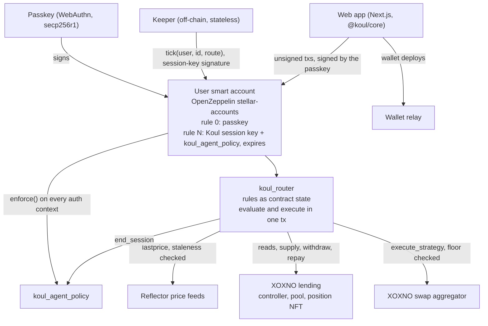
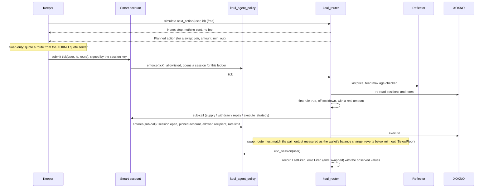

# Koul architecture

Koul lets you write trading rules for your own Stellar wallet. A Soroban contract stores the rules, checks them and
runs the trade from your passkey smart account. You keep your funds. Our keeper only says "check now".

Everything described as live runs on Stellar **testnet**. Code: [github.com/koul-me/koul](https://github.com/koul-me/koul) (MIT).

> We drafted the architecture with AI, working from our code, and checked the numbers, addresses and transactions
> against the code, the chain and the provider docs.

---

## 1. The core idea

**The rules, the decision and the trade happen on-chain. The keeper is just a clock.**

If our keeper stops, rules stop firing. It can't make up a trade, send funds anywhere except the user's own positions,
or touch another account.

## 2. Why Stellar

Koul needs four things Stellar has built in:

- **Accounts that run their own checks.** A smart account's `__check_auth` runs our policy on every call Koul's key
  signs, sub-calls included. That policy is Koul's safety model.
- **Passkeys checked on-chain.** The network verifies secp256r1 signatures, so a phone passkey owns the wallet. No seed
  phrase, and no server holding a key.
- **Read, decide and act in one call.** One Soroban call reads XOXNO and Reflector, checks the rules and trades. If
  anything changed since the keeper looked, it does nothing.
- **Cheap checks.** The keeper simulates every autopilot for free and pays only when something runs.

---

## 3. Components

| Component | Built on | Job |
|---|---|---|
| `koul_router` | Soroban contract (Rust, soroban-sdk 26.1) | Stores each user's autopilots. On `tick` it re-reads the market, picks the first rule that is true and off cooldown, and runs it. One action per tick. |
| `koul_agent_policy` | OpenZeppelin `Policy` on a smart-account context rule | Limits what Koul's session key can sign (section 6). |
| User smart account | OpenZeppelin `stellar-accounts` (rev `1e513890`), deployed with Sembol and smart-account-kit 0.6.2 | Rule 0 is the user's passkey. A second rule holds Koul's session key and the policy, and expires after 1 to 30 days. Deleting it stops everything. |
| Keeper | TypeScript, `@stellar/stellar-sdk` 16.4.1 | Simulates, and submits a tick only when the router says something is due. Holds no funds, makes no decisions, keeps no state. |
| `@koul/core` | TypeScript SDK | Contract types, encoding, validation, reads and unsigned transaction builders, shared by the app and the keeper. |
| Web app | Next.js | Every write is an unsigned transaction the user signs with a passkey. The chat that drafts rules returns data only; nothing changes until the user signs. |
| Wallet relay | `web/app/api/relay` | Pays for wallet deploys and passes everything else to SDF's public relayer. |
| Reflector | Price feeds (`lastprice`) | Prices for conditions and swap floors. Each feed has a max age (900 s on testnet), and a stale price never matches. |
| XOXNO | Lending controller, pool, position NFT, swap aggregator | Where the money goes. The position NFT's id is the user's XOXNO account id, so we don't store it. On testnet, the aggregator's swaps settle in Soroswap pools. |
| `koul_mock_fx` | Reflector's read interface | Testnet-only mock feed. Off in the app and not used on mainnet. |

---

## 4. Rules

- An **autopilot** is an ordered list of up to 32 rules.
- A **rule** has 1 to 3 conditions (all or any), one action and a cooldown. Without the cooldown, a rule that stays
  true would fire on every pass and eat fees.
- **Conditions:** health factor, supply rate, rate gap between two hubs, idle USDC, token balance, token price.
- **Actions:** supply, move supply between hubs, repay, repay with collateral, withdraw, swap, withdraw and swap. Swaps
  cover XLM, ETH, SOL, XRP, wBTC, BTC, USDT and EURC.
- No if/else and no nesting. Simple rules are easier to read, to check on-chain and to show in the app.

Everything that matters is on-chain:

| Data | Stored in | On-chain |
|---|---|---|
| Rules | Router, `Autopilot(user, id)` | Yes |
| Cooldowns | Router, `LastFired(user, id, rule_index)` | Yes |
| What the session key may do | Policy, `Params(smart_account, rule_id)` | Yes |
| The session key and its expiry | Smart-account context rules | Yes |
| What happened | `Fired`, `Swapped`, `AutopilotSet`, `AutopilotCleared` events | Yes |
| Keeper heartbeat, status page | Redis | No, monitoring only |

Anyone can read an autopilot with `get_autopilot(user, id)` and see each condition's live value with `check(user, id)`.

Contract functions: who signs and what they touch

`koul_router` (`contracts/koul_router/src/lib.rs`):

| Function | Who must authorise | Storage it touches |
|---|---|---|
| `__constructor(admin, controller, pool, usdc, oracle, spoke_id)` | Deployer, once | Instance: admin, config |
| `upgrade(new_wasm_hash)` | Admin | Contract wasm (address and storage unchanged) |
| `set_oracle(oracle)` | Admin | Instance: config |
| `set_feed(token, feed)` | Admin | Persistent: `Feed(token)` |
| `set_aggregator(aggregator)`, `set_policy(policy)` | Admin | Instance |
| `set_autopilot(user, id, autopilot)` | `user` (the passkey) | Persistent: `Autopilot(user, id)`, `Ids(user)`, `Users`; clears `LastFired` |
| `clear_autopilot(user, id)` | `user` | Removes the same entries |
| `tick(user, id, route)` | `user`: the passkey, or the session key through `koul_agent_policy` | Persistent: `Autopilot` (TTL extended), `LastFired(user, id, i)`; calls XOXNO, the aggregator and `end_session` |
| `check(user, id)`, `next_action(user, id)` | None (read-only, simulated) | Reads XOXNO, Reflector and balances |
| `get_autopilot`, `list_ids`, `list_users`, `get_config`, `get_feed`, `get_aggregator`, `get_policy` | None | Reads |

`koul_agent_policy` (`contracts/koul_agent_policy/src/lib.rs`):

| Function | Who must authorise | Storage it touches |
|---|---|---|
| `install(params, context_rule, smart_account)` | The smart account (the passkey, when the key is granted) | Persistent: `Params(smart_account, rule_id)` |
| `uninstall(context_rule, smart_account)` | The smart account | Removes `Params` and `Window` |
| `enforce(context, signers, context_rule, smart_account)` | The smart account, from its `__check_auth` | Temporary: `Session(smart_account)`; persistent: `Window(smart_account, rule_id)` |
| `end_session(smart_account)` | The router that opened the session | Removes `Session` |
| `get_session`, `get_params`, `get_window` | None | Reads |

---

## 5. One tick

- **The keeper's simulation is only a hint.** The router checks everything again when the tick runs. A wrong or
  dishonest keeper gets a tick that does nothing.
- **The router sets the swap floor.** It computes `min_out` from Reflector prices less the rule's slippage (20% at
  most). The keeper only supplies the route. A route for another pair fails with `RouteMismatch`, and too little output
  fails with `BelowFloor`.
- **Fees.** Simulation is free. The keeper pays a network fee only when an action runs, and users pay nothing per check.
- Code: `tick` and `next_action` in `contracts/koul_router/src/lib.rs`, `enforce` in
  `contracts/koul_agent_policy/src/lib.rs`, the loop in `keeper/src/keeper.ts`.

---

## 6. Security

### What the session key can do

The smart account calls the policy's `enforce` for every call the session key signs. Each call must pass all of these:

| Check | Error if broken |
|---|---|
| A signer is present | `7101 NoSigners` |
| The `(contract, function)` pair is on the allowlist built from the user's rules | `7103 CallNotAllowed` |
| Anything but `tick` runs inside a session that `tick` opened in the same ledger | `7110 NoSession` |
| `transfer` goes only to an allowed recipient (the XOXNO pool or the aggregator) | `7104 TransferRecipientNotAllowed` |
| XOXNO `supply`, `withdraw`, `repay` name the user's own pinned account id | `7108 AccountNotAllowed` |
| `withdraw` sends only to the smart account itself | `7109 WithdrawRecipientNotAllowed` |
| A swap names the smart account as sender, so the output comes back to the wallet | `7111 SenderNotAllowed` |
| Rate limit: 40 calls per 2,000 ledgers by default | `7106 RateLimited` |

The router closes the session before `tick` returns, so the key can't call XOXNO, a token or the aggregator directly.
You can try it: `cd keeper && pnpm session-deny` sends three direct calls signed by the session key, and the chain
rejects each one with `7110 NoSession`.

**Why not a vault?** If funds sat in our contract, we would be a custodian, and one bug would hit every user. Instead
the user keeps the funds and grants a key that is scoped, rate-limited and expires.

### If the keeper or the key is compromised

It can:

- stop ticking, so rules stop firing. The user still controls everything with the passkey;
- pick the moment within the window a condition is true. Cooldowns and the rate limit cap how often;
- pick the swap route. The router fixes the pair, the amount and the floor, so the most it can take is the rule's
  slippage.

It can't run a rule that is false, withdraw anywhere but the wallet, touch another account, borrow, or call anything
outside a tick.

### Two known gaps

Both depend on the router being honest, and the same fix closes both.

- **Gap A, the session close.** The policy trusts the router to call `end_session`. A router that skipped it would leave
  the session open for the rest of that ledger, and the key could call an allowlisted function directly.
- **Gap B, the swap floor.** The floor holds while the router code and its feeds are honest. A malicious upgrade could
  swap through the allowlisted aggregator with a bad route, and a wrong feed (`set_oracle`, `set_feed`) would move the
  floor.

**The fix.** Before mainnet, the router admin moves to a 2-of-3 multisig with a published delay of at least 48 hours
on `upgrade`, `set_oracle` and `set_feed`, so users can revoke before new code or a new feed takes effect. Per-venue
scopes will let a user grant a
key that can't swap at all, and the deviation guard refuses a price that a second source disagrees with. The
negative-authorization tests before mainnet cover gap A.

### The router admin

One admin account (`GCCIYVPB…LBYG4`) can `upgrade` the router and call `set_oracle`, `set_feed`, `set_aggregator` and
`set_policy`. It is the main trust point today.

- A malicious upgrade still can't withdraw anywhere but the wallet, pay anyone outside the allowlist, touch another
  XOXNO account or borrow. It could use gaps A and B. So a bad router puts value at risk, but can't send funds
  elsewhere.
- `set_aggregator` can't redirect swaps. The policy allowlists the aggregator by address, so a new one fails with `7103`.
- `set_oracle` and `set_feed` change the prices the router trusts.

Before mainnet the admin becomes a 2-of-3 multisig, with the 48-hour delay above. Whether the router later becomes
immutable is something we decide after
the security checks.

### Single points of failure

| Part | Risk today | What we do about it |
|---|---|---|
| Session key (one Koul key) | A leak lets someone call the router with it | Limited by the policy; users remove it with the passkey; key rotation planned |
| Router admin key | One account can upgrade the router and change its prices | Multisig before mainnet |
| Keeper | Runs on GitHub Actions; scheduler gaps stopped it on 2 November | Each run starts the next; an always-on keeper and a fallback keeper on mainnet |
| RPC | One public provider; on 2 November a pass over 97 wallets went from 1-2.5 s to 20-67 s | Our own RPC plus a second one (`STELLAR_RPC_URL` is already configurable) |
| XOXNO quote server | One route source | The router trusts nothing in a route: it checks the pair, sets the amount, measures the output and enforces the floor |
| Prices | Stale or wrong | Max age per feed, and a stale price never matches. Pyth plus Reflector with a deviation guard (planned) |
| Wallet relay | We pay for wallet deploys | Alerts (planned) |
| Other contracts' rent | A dependency's lease running low once made every call quote 566 XLM | A daily lease guard extends anything under 30 days to 90 |

### Keys

| Key | Can do | Stored |
|---|---|---|
| User passkey | Controls the smart account | The user's device or password manager; it never leaves it |
| Session key (`GBVD753E…TSAK3`) | Holds no funds; acts only through the policy | The keeper's CI secret |
| Keeper and channel accounts (`GAFHZTSL…GXP6U`) | Testnet XLM for fees | CI secret |
| Router admin (`GCCIYVPB…LBYG4`) | The admin functions above | One key on one team machine, not in CI; multisig before mainnet |

### What we run and what we depend on

| | Part | If it fails |
|---|---|---|
| We run | Keeper (GitHub Actions) | Rules stop firing; funds are untouched |
| We run | Web app and wallet relay (Vercel) | No new wallets or edits in the app; autopilots keep running |
| We run | Status data (Upstash Redis) | Monitoring goes blind; nothing on-chain changes |
| We run | `koul_router`, `koul_agent_policy`, the admin key | See the gaps above |
| External | XOXNO contracts and quote server | Lending or swap rules can't run; a bad quote is refused |
| External | Reflector feeds | Price rules don't match, and swaps are refused while a price is stale |
| External | OpenZeppelin smart account and verifiers | Signing fails; nothing moves |
| External | Stellar RPC and SDF's relayer | Ticks slow down or stop; a second RPC is planned |

### Threats (STRIDE)

A full threat model is planned; this is the short version.

| Threat | Example | Answer today |
|---|---|---|
| Spoofing | Someone gets the session key | Policy limits; the user removes the key; rotation planned |
| Tampering | The keeper sends a bad route | The router fixes pair and amount, and reverts below the floor |
| Repudiation | A user disputes an action | `Fired` and `Swapped` record the values the router saw; the policy emits `KoulEnforced` per call |
| Denial of service | The keeper or RPC stops; a stolen key burns the rate limit | Rules pause and funds stay; the limit resets after 2,000 ledgers (about 2.8 h); fallback keeper and second RPC planned |
| Elevation of privilege | The admin upgrades to malicious code | Gaps A and B; multisig and upgrade policy before mainnet |

---

## 7. The keeper today

- Runs on GitHub Actions. Each run lasts 5 h 40 min and starts its own successor.
- Checks every autopilot, waits 15 seconds, then starts again. On the public testnet RPC a full pass over 106
  autopilots takes 80 to 150 s (koul.me/status), so a rule can wait that long after it turns true.
- Reads wallets in parallel, then submits through 32 channel accounts with one worker each, so transactions never
  fight over a sequence number.
- Shuffles wallet order every pass, so the same wallets don't always trade first on thin pools.
- Two keepers at once are safe. The router checks cooldowns, so the slower one simply sends nothing.
- Keeps no state. It reads users and autopilots from the router on every pass, so it can restart anywhere.
- Sends a heartbeat to koul.me/status, and alerts us when it falls behind or a contract lease needs attention.

**Why our own keeper?** Soroban has no built-in scheduler. In SoroCron the executor contract is the caller, so it can't
carry the user's smart-account authorisation. Because our keeper only submits what the router allows, it could later
run on a shared keeper network such as Nectar.

---

## 8. Testnet deployments and proofs

| Contract | Address | Wasm hash |
|---|---|---|
| `koul_router` | [`CD5VSBUXQ4OQIVYI55CFF4C4YKSFQUY4OTFIOFJRNC6TUILMNN7MAO2D`](https://stellar.expert/explorer/testnet/contract/CD5VSBUXQ4OQIVYI55CFF4C4YKSFQUY4OTFIOFJRNC6TUILMNN7MAO2D) | `263641f1…d103f296` (upgraded in place) |
| `koul_agent_policy` | [`CAKEUMCIW4KBQZI5OJMFHFGM5VHDZHWIXAO7JOKTBRPR63IHIEP7KKNZ`](https://stellar.expert/explorer/testnet/contract/CAKEUMCIW4KBQZI5OJMFHFGM5VHDZHWIXAO7JOKTBRPR63IHIEP7KKNZ) | `136b671b…ee4e89` |
| `koul_mock_fx` (testnet only) | [`CB6VNXADXR3XHCS4EKV5ZR5UJUZYQ5BZTPRHCNQE3XMKQMB4LJG6MKW2`](https://stellar.expert/explorer/testnet/contract/CB6VNXADXR3XHCS4EKV5ZR5UJUZYQ5BZTPRHCNQE3XMKQMB4LJG6MKW2) | `68d24e07…8532f0` |

Contracts Koul calls

| Integration | Address |
|---|---|
| XOXNO controller | [`CCXRWJ6SIU2WPFEGLFGJVITPL57QAYIMIO6OAM2NBGNDQSSCK2FFV3F3`](https://stellar.expert/explorer/testnet/contract/CCXRWJ6SIU2WPFEGLFGJVITPL57QAYIMIO6OAM2NBGNDQSSCK2FFV3F3) |
| XOXNO pool | [`CBSGF6QOQAMPFBEVSYPEQHSZRIHJ6RCGUPCRDMUX36DEKRWFAO2PZB5A`](https://stellar.expert/explorer/testnet/contract/CBSGF6QOQAMPFBEVSYPEQHSZRIHJ6RCGUPCRDMUX36DEKRWFAO2PZB5A) |
| XOXNO swap aggregator | [`CDNTWMWW2WGYTKIZTJYNGNVQQZI4KTC5BQRZ3275KESRX5T4O3AYECL5`](https://stellar.expert/explorer/testnet/contract/CDNTWMWW2WGYTKIZTJYNGNVQQZI4KTC5BQRZ3275KESRX5T4O3AYECL5) |
| Reflector feed (swap floors) | [`CCYOZJCOPG34LLQQ7N24YXBM7LL62R7ONMZ3G6WZAAYPB5OYKOMJRN63`](https://stellar.expert/explorer/testnet/contract/CCYOZJCOPG34LLQQ7N24YXBM7LL62R7ONMZ3G6WZAAYPB5OYKOMJRN63) |
| WebAuthn verifier | [`CC7EKIHQP3TN4CARQDND6CEOY2UXLWWC2X5GHTD5NLAT7BG5GPZIOM3F`](https://stellar.expert/explorer/testnet/contract/CC7EKIHQP3TN4CARQDND6CEOY2UXLWWC2X5GHTD5NLAT7BG5GPZIOM3F) |
| Ed25519 verifier | [`CAAVTMCBXEIBPR64EAASKFXERVPYFZA2JYP5A3BG6PESWEFUJX5IHKN4`](https://stellar.expert/explorer/testnet/contract/CAAVTMCBXEIBPR64EAASKFXERVPYFZA2JYP5A3BG6PESWEFUJX5IHKN4) |

Proofs:

- A user's rule firing on its own, 40 USDC into ETH:
  [`5ce0a903…72a6e`](https://stellar.expert/explorer/testnet/tx/5ce0a9032f454ab87a8f26aa5c5010a05925fe145f564d003bc9112d07872a6e)
- The session key rejected outside a tick: `cd keeper && pnpm session-deny` (`7110 NoSession`, three times).

### Check it yourself

| Check | Command | Pass condition |
|---|---|---|
| Router tests | `cd contracts/koul_router && cargo test` | 14 passed (evaluation, ordering, cooldowns, amounts, liquidity caps, swap floor, route check, session close) |
| Policy tests | `cd contracts/koul_agent_policy && cargo test` | 3 passed |
| SDK tests | `cd packages/core && pnpm test` | 63 passed |
| Keeper tests | `cd keeper && pnpm test` | 9 passed |
| Web app tests | `cd web && pnpm test` | 136 passed |
| Session key outside a tick | `cd keeper && pnpm session-deny` | Three direct calls, each rejected with `7110 NoSession` |
| Contract leases | `cd keeper && pnpm leases --dry` | No entry reported as failed, missing or too expensive |
| Keeper liveness | https://koul.me/status | Headline "All systems running" |
| Load test, 28 October 2026 | The router's events for that day | 57 wallets created on app.koul.me, each trading USDC and ETH through the keeper for under an hour; 740 trades |

Contract tests need Rust 1.91.1 and the stellar CLI 27 (`source scripts/env.sh`).

---

## 9. Planned

None of this is live yet.

### Indicators and a price recorder

- Rules gain SMA, EMA, RSI and "crosses above / below".
- The router computes them inside the tick, in fixed-point maths. A cross is something the contract sees, not something
  the keeper reports.
- Reflector's feed gives 5-minute prices for the last 24 hours, at most 20 per call (`prices`, SEP-40). That is enough
  for short indicators only.
- For longer ones, a small recorder contract copies Reflector's `lastprice` into the current period's slot if the slot
  is empty. Anyone can call it and it takes no price input, so the worst a caller can do is not call it.
- Indicator conditions per tick are capped, based on measured costs, to stay inside Soroban's resource limits.

### Pull prices (Pyth Pro) with Reflector as a second source

- Price rules wait for Reflector's 5-minute updates today. With Pyth, the keeper brings a signed price into `tick`, the
  same way it brings a swap route now.
- The router calls Pyth's verifier itself (`verify_update`, through `pyth-lazer-stellar-sdk`), so it never trusts a
  price the keeper parsed.
- It rejects updates older than a max age, and stores the last timestamp it used per feed, so an older update is
  refused even with a valid signature.
- Reflector stays as the second source. If Pyth and Reflector disagree by more than a set percentage, the action
  doesn't run. Reflector moves every 5 minutes, so the tolerance allows for that lag.
- Pyth Pro is a paid subscription, but anyone can verify its updates on-chain. Verifier: mainnet
  `CACZ3GBAKUPIAFRILUFO27J5RUH5GJ2VSJ46LP6GJYSKGDRTQ5MS3HCH`, testnet
  `CAYFT5JE3UQTKT4Q6ZOZK4FXVYVT6RE3MFC7STA4UB6WAEGBT65MRU52`.

### Portfolio cap, circuit breaker and fee

- The router values everything the autopilot can see: idle USDC, XOXNO collateral minus debt, and every token at its
  Reflector price.
- **Portfolio cap:** an action worth more than a set share of that total is skipped.
- **Circuit breaker:** the router stores the account's peak value. A set drop from the peak pauses every rule, or moves
  the account to USDC if the user chose that.
- **Fee:** 0.10% of the value moved, capped at $5, paid in the same tick to a fee address the policy allows. `Fired`
  shows the fee.

### Trailing stops and brackets

- A trailing stop stores the highest price since it was armed and fires on a set fall from it. `check` shows the
  stored peak.
- The keeper only ticks when something runs, so each check also looks at the highest price since the peak was last
  saved.
- A bracket pairs a take-profit with a stop-loss. When one fires, the router disarms the other in the same transaction.

### Zenex perpetuals

- Zenex is a perpetuals exchange live on Stellar mainnet (XLM-USD market
  `CAOZCITWHWAXH5FRU4EULQ5EN2HMTCHICRNC4R5ZAOVD7XHCCQSJ42IB`). It also has a testnet market,
  `CCOIDO46A4HHBOQQSHKY3RC6BM6HE3V7UMYNICG7PA7ABS422W672F6U`.
- A Zenex trade is an order. The router calls the market's `create_order` from the user's smart account, and that
  function only needs the user's authorisation. Zenex's own keepers fill the order, usually in the next ledger, with
  their own price reports, so Koul needs no price-report access.
- Actions: open, increase, reduce, close, add margin. Conditions: funding rate, distance to liquidation and PnL. Zenex
  has no view for the last two, so the router computes them from the position and a price.
- Cross-venue rules, for example moving funds from XOXNO into Zenex margin. Margin lands at the fill a ledger later,
  so these rules fire with a buffer.
- We test in a local Soroban environment running Zenex's deployed market code, and on Zenex's testnet market.

### Per-venue key scopes and key rotation

- Today one allowlist covers everything. The plan splits it by venue (XOXNO lending, the aggregator, Zenex), each with
  its own calls, recipients and rate limit. A user could grant lending only.
- Koul's key sits on each account as an external signer, so changing it today needs every user's passkey. The plan
  points that signer at `koul_agent_policy`, which maps a fixed key id to the current key. One transaction from us
  rotates it. The same policy still binds the new key, and the user can still remove it.

### Backtester

- Runs the deployed `koul_router` wasm in a local Soroban host over recorded prices, and shows what would have fired
  before the user arms a rule.
- It is the same code as on-chain, so we can check its output against the router's real `Fired` events, rule for rule.

### Mainnet keeper

- Moves from GitHub Actions to a Cloudflare Durable Object. Its alarm runs once per ledger: read the ledger, simulate
  what is due, submit, set the next alarm.
- Durable Object alarms run at least once and retry on errors. A location hint puts the object next to its own RPC.
- A second RPC, and a fallback keeper on separate infrastructure. Running two keepers is already safe (section 7).

### Security checks before mainnet

- An internal review of `koul_router`, `koul_agent_policy` and the price recorder against a full threat model.
- Negative-authorization tests (calls the policy must refuse, like `pnpm session-deny`, including gap A), property
  tests and fuzz tests.
- Every finding fixed before deploy, with the review and the tests published in the repo.

---

## 10. Mainnet plan

1. The security checks done and published.
2. `koul_mock_fx` removed. The router reads Pyth and Reflector mainnet feeds, with max-age checks and the deviation
   guard.
3. The router admin on a 2-of-3 multisig, with a published delay of at least 48 hours on `upgrade`, `set_oracle` and
   `set_feed`, before any user funds are involved.
4. The new keeper, a second RPC and a fallback keeper, with alerts for the heartbeat, failing ticks, policy rejections,
   stale or disagreeing prices, and keeper, channel and relay balances.
5. Backup passkeys, so losing one device doesn't lock a user out, and a cap of $1,000 per account under automation for
   the first 60 days.
6. The daily lease guard covering every contract we touch, ours and our dependencies'.
7. Tagged releases, and the contracts source-verified on stellar.expert. `koul_agent_policy` is published as a
   documented, reusable policy with an integration guide, so other teams can give an agent key the same on-chain
   limits.

## 11. After mainnet

Today the keeper is trustless but not permissionless: only Koul's session key can authorise a `tick`. An OpenZeppelin
context rule can have no signer, only a policy. A signer-less version of `koul_agent_policy` would let anyone run ticks,
so rules would no longer depend on us staying online. Two things need fixing first: griefing of the rate limit (`tick`
should revert when nothing runs) and route MEV from a profit-seeking keeper (tighter default slippage, or a route the
router computes itself).
