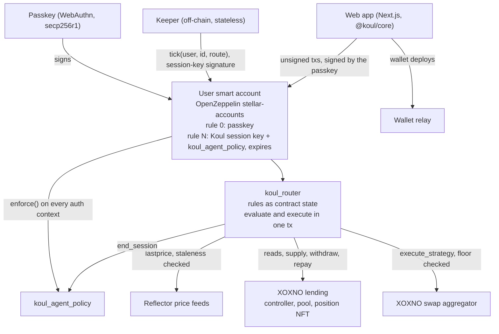
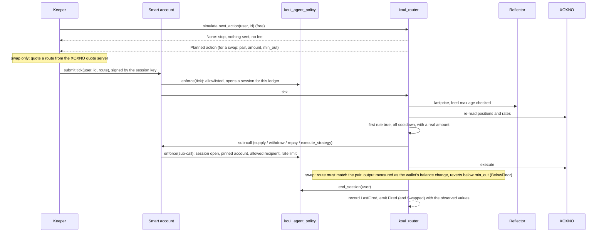

# Koul: technical architecture

Koul lets a person write "if this, then that" rules for their money on Stellar. The rules run from the person's own
passkey smart account, and the person keeps custody. This document covers how Koul uses Stellar today, component by
component, and what the SCF #46 Build Award would fund: taking the Koul autopilot from testnet to mainnet.

Everything described as live runs on Stellar **testnet**. Code: https://github.com/koul-me/koul (MIT). Every on-chain
change is logged with its transaction hash in [`docs/build-log.md`](build-log.md).

---

## 1. The design in one line

**The rules, the decision and the execution are on-chain. The keeper is only a clock.**

Safety is enforced on-chain, and liveness comes from off-chain. A keeper can stop rules from firing. It cannot invent
an action, move funds anywhere except the user's own position, or touch another account.

---

## 2. Components

| Component | Stellar primitive | What it does |
|---|---|---|
| `koul_router` | Soroban contract (Rust, soroban-sdk 26.1) | Stores each user's autopilots as persistent contract state. On `tick` it re-reads the world, picks the first rule that is true, off cooldown and has a real amount to move, and executes it in the same transaction. At most one action per tick. |
| `koul_agent_policy` | OpenZeppelin `Policy` on a smart-account context rule | Confines Koul's session key. Runs `enforce` on the root call and on every sub-invocation the key authorises (section 5). |
| User smart account | OpenZeppelin `stellar-accounts` (rev `1e513890`), deployed through Sembol and smart-account-kit 0.6.2 | Rule 0 holds the user's passkey (WebAuthn verifier). A second context rule holds Koul's Ed25519 session key bound to `koul_agent_policy`, with an expiry of 1 to 30 days. Removing that rule stops everything at once. |
| Keeper | TypeScript, `@stellar/stellar-sdk` 16.4.1 | Lists users and autopilots from the router, simulates, and submits a tick only when the router says an action applies. Holds no user funds, makes no decisions, keeps no state. |
| `@koul/core` | TypeScript SDK | Types that mirror the contracts, the ScVal codec, validation against the contract's limits, reads, and unsigned write builders. Shared by the app and the keeper. |
| Web app | Next.js | Every write is an unsigned transaction the user signs with their passkey. The chat that turns a sentence into rules returns data only; it is validated against the contract's limits and becomes state only after the user signs. |
| Wallet relay | `web/app/api/relay` | Pays for wallet deploys and passes every other request on to SDF's public relayer. |
| Reflector | Price feeds (`lastprice`) | Prices for price conditions and for the swap floor. Each feed is registered with a maximum age (900 s on testnet); a missing or stale price never matches. |
| XOXNO | Lending controller, pool, position NFT, swap aggregator | The venues. The position NFT's token id is the user's XOXNO account id, so the app finds a position without storing anything. |
| `koul_mock_fx` | Reflector's read interface | Testnet only: USD/TRY, which no Reflector testnet feed carries. Off in the app. Removed on mainnet with one `set_oracle` call. |

---

## 3. The rule model

- An **autopilot** is an ordered list of up to **32 rules** (`MAX_RULES`).
- A **rule** has **1 to 3 conditions** (`MAX_CONDITIONS`) joined by all or any, one action, and a mandatory cooldown in
  ledgers. A condition that stays true would otherwise fire every pass and grind a position down through fees.
- **Conditions:** health factor, supply rate, supply-rate gap between two hubs, idle USDC, token balance, token price
  (Reflector).
- **Actions:** supply from the wallet, move supply between hubs, repay from the wallet, repay with collateral,
  withdraw to the wallet, swap from the wallet, withdraw and swap. Swaps cover XLM, ETH, SOL, XRP, wBTC, BTC, USDT and
  EURC.
- No if/else and no nesting. That keeps a rule easy to read, to validate on-chain and to show honestly in a UI.

| Data | Where | On-chain |
|---|---|---|
| Rules (`Autopilot { account_id, rules }`) | Router persistent storage, `Autopilot(user, id)` | Yes |
| Cooldown state | `LastFired(user, id, rule_index)` | Yes |
| What the session key may do | Policy storage, `Params(smart_account, rule_id)` | Yes |
| That the session key exists, and its expiry | Smart-account context rules | Yes |
| What happened | `Fired`, `Swapped`, `AutopilotSet`, `AutopilotCleared` events | Yes |
| Keeper heartbeat, status page data | Redis | No, monitoring only |

Anyone can read an autopilot with `get_autopilot(user, id)`, and the live truth of each condition, with the value it
was compared against, with `check(user, id)`.

---

## 4. One tick, end to end

- **Read, decide and write happen in one transaction.** The keeper's simulation is only a hint. If the keeper is wrong
  or dishonest, the router re-evaluates at execution and the tick does nothing.
- **The swap floor.** The router computes `min_out` itself from the Reflector prices of both tokens less the rule's
  slippage (contract cap 20%, `MAX_SLIPPAGE_BPS = 2000`). The keeper supplies only the route. The router rejects a
  route for any other pair (`RouteMismatch`), measures what actually arrived in the wallet, and reverts below the
  floor (`BelowFloor`).
- **Fees.** Simulation is free, so the keeper pays a fee only when an action runs. Users pay nothing per tick.
- Code: `tick` and `next_action` in `contracts/koul_router/src/lib.rs`, `enforce` in
  `contracts/koul_agent_policy/src/lib.rs`, the keeper loop in `keeper/src/keeper.ts`.

---

## 5. Security model

### The session key's limits (`koul_agent_policy`)

The smart account calls `enforce` for every authorisation context the session key signs: the root call and every
sub-call. A call goes through only if all of these hold:

| Check | Error if broken |
|---|---|
| A signer is present | `7101 NoSigners` |
| The `(contract, function)` pair is on the allowlist derived from the user's rules | `7103 CallNotAllowed` |
| Anything but `tick` runs inside a session that `tick` opened in the same ledger | `7110 NoSession` |
| `transfer` goes only to an allowed recipient (the XOXNO pool or the aggregator) | `7104 TransferRecipientNotAllowed` |
| XOXNO `supply`, `withdraw`, `repay` name the user's own pinned account id | `7108 AccountNotAllowed` |
| `withdraw` sends only to the smart account itself | `7109 WithdrawRecipientNotAllowed` |
| A swap names the smart account as sender, so the output comes back to the wallet | `7111 SenderNotAllowed` |
| Rate limit: 40 calls per 2,000 ledgers by default | `7106 RateLimited` |

The router closes the session (`end_session`) before `tick` returns. So the session key cannot call XOXNO, a token or
the aggregator directly, only through a router tick. This can be reproduced live: `cd keeper && pnpm session-deny`
sends three session-key-signed calls straight at the contracts, and the chain rejects each with `7110 NoSession`.

**Why not a vault.** If funds sit in our contract we are a custodian, and one bug is every user's loss. The user keeps
custody instead and grants a key that is scoped, rate-limited and expiring.

### What a compromised keeper or session key can do

- **Stop ticking.** Rules stop firing. The user can still do everything with the passkey and revoke the key.
- **Choose the timing** within the window a condition is true. Cooldowns and the rate limit bound how often.
- **Choose the swap route.** The router fixes the pair and the amount and enforces the floor, so the most a keeper can
  take is the rule's slippage.

It cannot run a rule whose condition is false, withdraw anywhere but the wallet, act on another account, borrow, or
call anything outside a router tick.

### The router admin

The router has one admin account (`GCCIYVPB…LBYG4`) with five functions: `upgrade` (replace the wasm in place, so the
address and every user's allowlist stay the same), `set_oracle`, `set_feed`, `set_aggregator` and `set_policy`. This
is the main trust point today.

- A malicious upgrade is still held by the policy: withdrawals only to the wallet, transfers only to allowlisted
  recipients, the pinned account, swaps only with the wallet as sender.
- `set_aggregator` cannot redirect swaps to a new contract. The aggregator call is authorised by the session key, and
  the policy allowlists the aggregator by address, so a new address fails with `7103`.
- `set_oracle` and `set_feed` can change the prices the router trusts, and with them conditions and swap floors.
  Within the allowlisted pairs, that could make a swap execute at a bad price.

Mainnet: the admin moves to a multisig and the upgrade policy is published (D7). An immutable router after the audit
is an option we will decide on with the auditor.

### Single points of failure

| Component | Risk today | Mitigation |
|---|---|---|
| Session key (one Koul key) | A leak lets someone call the router with it | Bounded by the policy above; users revoke in one tap. Rotation without asking users to re-grant in D2; key handling documented in D4 |
| Router admin key | One account can upgrade the router and change its oracle and feeds | Multisig before mainnet (D7) |
| Keeper liveness | Runs on GitHub Actions; scheduler gaps stopped it on 2 November | Each run already dispatches its successor; a second, independent runner in D5 |
| RPC | One public RPC provider; on 2 November a pass went from 1-2.5 s to 20-67 s | Failover across two providers in D5 (`STELLAR_RPC_URL` is already configurable) |
| XOXNO quote server | One route source | The router trusts nothing in a route (pair, amount, received amount, Reflector floor); Soroswap as a second venue in D3 |
| Oracle | Stale prices | Each feed has a maximum age; a stale price never matches. Reflector mainnet feeds in D7 |
| Wallet relay | Koul runs the relay that pays for wallet deploys | Monitored with alerts in D5 |
| Other contracts' rent | A dependency's wasm lease running low once made every call quote 566 XLM | A daily lease guard reads every contract Koul touches and extends anything under 30 days to 90 |

### Keys

| Key | Holds | Stored |
|---|---|---|
| User passkey | Controls the smart account | The user's device or password manager. Never leaves it |
| Session key (`GBVD753E…TSAK3`) | No funds; can only act through the policy | CI secret for the keeper |
| Keeper and channel accounts (`GAFHZTSL…GXP6U`) | Testnet XLM for fees | CI secret |
| Router admin (`GCCIYVPB…LBYG4`) | Admin functions in the section above | One key on one team machine, not in CI; multisig in D7 |

---

## 6. The keeper today

- Runs on GitHub Actions. Each run ticks every 15 seconds for 5 h 40 min and dispatches its own successor.
- Each pass has two phases. First it reads wallets in parallel; most have nothing due. Then it submits through 32
  channel accounts, one worker each, so no two transactions race on a sequence number.
- Wallet order is shuffled every pass, so the same wallets do not always trade first on thin pools.
- Two keepers are safe: the loser of a race simulates to `None` and spends nothing.
- It is stateless. Every pass it reads `list_users` and `list_ids` from the router, so it can be restarted anywhere.
- A heartbeat after every pass feeds the public status page (koul.me/status) and an owner alert, at most hourly, when
  the keeper is late or a lease needs a person.

**Why our own keeper.** Soroban has no native scheduler. In SoroCron the executor contract is the invoker, so it
cannot carry a user's smart-account authorisation. Koul's keeper could later run on shared keeper networks such as
Nectar, because it only submits what the router authorises.

---

## 7. Testnet deployments and proofs

| Contract | Address | Wasm hash |
|---|---|---|
| `koul_router` | [`CD5VSBUXQ4OQIVYI55CFF4C4YKSFQUY4OTFIOFJRNC6TUILMNN7MAO2D`](https://stellar.expert/explorer/testnet/contract/CD5VSBUXQ4OQIVYI55CFF4C4YKSFQUY4OTFIOFJRNC6TUILMNN7MAO2D) | `54d4f5b4…16dc01` |
| `koul_agent_policy` | [`CAKEUMCIW4KBQZI5OJMFHFGM5VHDZHWIXAO7JOKTBRPR63IHIEP7KKNZ`](https://stellar.expert/explorer/testnet/contract/CAKEUMCIW4KBQZI5OJMFHFGM5VHDZHWIXAO7JOKTBRPR63IHIEP7KKNZ) | `136b671b…ee4e89` |
| `koul_mock_fx` (testnet only) | [`CB6VNXADXR3XHCS4EKV5ZR5UJUZYQ5BZTPRHCNQE3XMKQMB4LJG6MKW2`](https://stellar.expert/explorer/testnet/contract/CB6VNXADXR3XHCS4EKV5ZR5UJUZYQ5BZTPRHCNQE3XMKQMB4LJG6MKW2) | `68d24e07…8532f0` |

| Integration | Address |
|---|---|
| XOXNO controller | [`CCXRWJ6SIU2WPFEGLFGJVITPL57QAYIMIO6OAM2NBGNDQSSCK2FFV3F3`](https://stellar.expert/explorer/testnet/contract/CCXRWJ6SIU2WPFEGLFGJVITPL57QAYIMIO6OAM2NBGNDQSSCK2FFV3F3) |
| XOXNO pool | [`CBSGF6QOQAMPFBEVSYPEQHSZRIHJ6RCGUPCRDMUX36DEKRWFAO2PZB5A`](https://stellar.expert/explorer/testnet/contract/CBSGF6QOQAMPFBEVSYPEQHSZRIHJ6RCGUPCRDMUX36DEKRWFAO2PZB5A) |
| XOXNO swap aggregator | [`CDNTWMWW2WGYTKIZTJYNGNVQQZI4KTC5BQRZ3275KESRX5T4O3AYECL5`](https://stellar.expert/explorer/testnet/contract/CDNTWMWW2WGYTKIZTJYNGNVQQZI4KTC5BQRZ3275KESRX5T4O3AYECL5) |
| Reflector feed (swap floors) | [`CCYOZJCOPG34LLQQ7N24YXBM7LL62R7ONMZ3G6WZAAYPB5OYKOMJRN63`](https://stellar.expert/explorer/testnet/contract/CCYOZJCOPG34LLQQ7N24YXBM7LL62R7ONMZ3G6WZAAYPB5OYKOMJRN63) |
| WebAuthn verifier | [`CC7EKIHQP3TN4CARQDND6CEOY2UXLWWC2X5GHTD5NLAT7BG5GPZIOM3F`](https://stellar.expert/explorer/testnet/contract/CC7EKIHQP3TN4CARQDND6CEOY2UXLWWC2X5GHTD5NLAT7BG5GPZIOM3F) |
| Ed25519 verifier | [`CAAVTMCBXEIBPR64EAASKFXERVPYFZA2JYP5A3BG6PESWEFUJX5IHKN4`](https://stellar.expert/explorer/testnet/contract/CAAVTMCBXEIBPR64EAASKFXERVPYFZA2JYP5A3BG6PESWEFUJX5IHKN4) |

Transactions:

- A user's rule firing on its own, 40 USDC into ETH:
  [`5ce0a903…72a6e`](https://stellar.expert/explorer/testnet/tx/5ce0a9032f454ab87a8f26aa5c5010a05925fe145f564d003bc9112d07872a6e)
- Withdraw from XOXNO and swap into XLM in one tick:
  [`29a8aa97…da064e`](https://stellar.expert/explorer/testnet/tx/29a8aa974fa1ca3df2b24458c9e79854a6c5c4cd102e62bfc5ca08db37da064e)
- The session key rejected outside a tick: `cd keeper && pnpm session-deny` (`7110 NoSession`, three times).

Tests: `koul_router` 14 (rule evaluation, ordering, cooldowns, amounts, swap floor, session close), `koul_agent_policy`
3, plus the SDK and web app suites.

---

## 8. What the award builds

One product: the Koul autopilot on mainnet. Each line names its Stellar integration and how completion is measured on
chain. 130 dev-days at $600 ($75 an hour), two engineers.

### Tranche 1 (MVP), completion 29/01/2027

| | Deliverable | Stellar integration | Completion | Days | Owner |
|---|---|---|---|---|---|
| D1 | Router v3: portfolio-level cap and protocol fee, richer `Fired` event | `koul_router` | Testnet contract ID and tagged release; tests for the cap, fee rounding and fee cap; a testnet tx where a rule over the cap is refused; a testnet tx showing the fee in `Fired` | 15 | Atahan |
| D2 | Policy v3: per-venue session scopes, session-key rotation without re-granting, property and fuzz tests | `koul_agent_policy`, OpenZeppelin `stellar-accounts` | Test report; per venue, a testnet run with the key rejected outside a tick (`7110`); a rotation tx with existing autopilots still firing after it | 14 | Atahan |
| D3 | Soroswap as a second swap venue, with the same Reflector floor; the keeper quotes both venues and falls back to Soroswap | Soroswap router, Reflector | A rule-fired swap through Soroswap on testnet; a negative test reverting below the floor; a keeper log showing the fallback | 10 | Ahmed |

### Tranche 2 (Testnet), completion 05/03/2027

| | Deliverable | Stellar integration | Completion | Days | Owner |
|---|---|---|---|---|---|
| D4 | STRIDE threat model of the router, the policy, the keeper and the relay; on-chain monitoring plan; key-management document | All contracts | Three documents in the repo; alerting live on testnet (failing ticks, policy rejections, oracle staleness, balances); an alert drill with its log | 10 | Atahan |
| D5 | A second keeper runner independent of GitHub Actions, failover across two RPC providers, relay monitoring, all shown on the existing koul.me/status | Stellar RPC | A failover drill with one runner and one RPC provider down, autopilots still firing (testnet tx hashes during the drill) | 13 | Atahan |
| D6 | Passkey recovery (a second passkey or device on the smart account), a shorter onboarding path, a plain-language explanation of every rule with its fee before signing | OpenZeppelin smart account, WebAuthn verifier | A testnet tx adding a second passkey signer; recovery working on a second device; every rule type shows its explanation and fee before signing (test suite) | 16 | Ahmed |

### Tranche 3 (Mainnet), completion 11/06/2027

| | Deliverable | Stellar integration | Completion | Days | Owner |
|---|---|---|---|---|---|
| D7 | Audit Bank remediation; `koul_router` and `koul_agent_policy` on mainnet on the current OpenZeppelin release with Reflector mainnet feeds; router admin moved to a multisig | Mainnet, Reflector, OpenZeppelin | Mainnet contract IDs; audit report with every critical, high and medium finding fixed; the multisig admin visible on-chain | 20 | Atahan 13, Ahmed 7 |
| D8 | Mainnet keeper and relay, passkey wallet creation on mainnet, and XOXNO lending, XOXNO aggregator and Soroswap flows live with the protocol fee | XOXNO, Soroswap, mainnet | One mainnet tx per flow (supply, move between pools, repay, withdraw, swap through each venue); a rule firing on its own on mainnet; the fee received at the fee address | 18 | Ahmed |
| D9 | Public usage dashboard (external and team accounts shown apart: value moved by rules, executed actions, autopilots still armed after 30 days) and open-source release of both contracts and the keeper | Router events | Dashboard URL live with the split; licence and tagged release in the repository | 14 | Ahmed |

Not in this award: the lira on and off ramp, cross-chain funding through Niet, DeFindex and a public SDK. Audit costs
go through the Audit Bank, and nothing is billed for work already done.

---

## 9. Mainnet plan

1. **Audit.** Apply to the Audit Bank once Tranche 2 is verified. The router and the policy are small and
   self-contained, which keeps the audit affordable.
2. **Oracle.** `koul_mock_fx` goes away. The router reads Reflector's mainnet feeds through `set_oracle` and `set_feed`,
   with the same per-feed maximum-age checks.
3. **Admin.** The router admin moves to a multisig before any user funds are involved, with a published upgrade policy.
4. **Monitoring.** The D4 alerting and D5 redundancy carry over to mainnet before launch: the keeper heartbeat,
   failing ticks, policy rejections, oracle staleness, and keeper, channel and relay balances.
5. **Rent.** The daily lease guard runs against mainnet and covers every contract Koul touches, ours and our
   dependencies'.
6. **Open source.** Both contracts and the keeper are released under MIT with a tagged release (D9). The repository is
   already public.

---

## 10. Next, after this award

Today the keeper is trustless but not permissionless: `tick` needs the user's authorisation, and only Koul's session
key provides it. An OpenZeppelin context rule can have no signers and only a policy. A signer-less variant of
`koul_agent_policy` with the same checks would let anyone submit a tick, so liveness would stop depending on us. Two
risks need closing first: rate-limit griefing (fix: `tick` reverts when nothing runs) and route MEV from a
profit-seeking keeper (fix: tighter default slippage, or a path the router computes itself). This is not in the
budget above.
